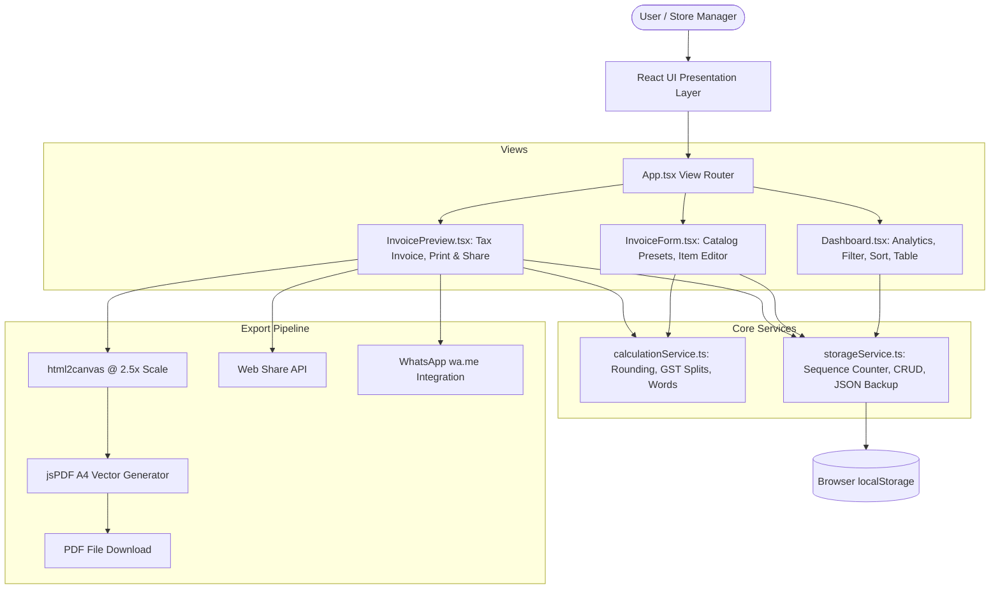

# System Architecture — Aakash Furniture Invoicing System

## 1. Architectural Overview

The **Aakash Furniture Invoicing System** is an offline-capable, single-page application (SPA) built with React 19, TypeScript, Tailwind CSS v4, and Vite. It is designed specifically for **Aakash Furniture** (Bhopal, M.P., India) to handle commercial and retail furniture billing, compliance with Indian GST regulations (intra-state CGST+SGST / inter-state IGST), instant PDF rendering, and direct WhatsApp invoice sharing.

---

## 2. Component Hierarchy & Responsibilities

### `App.tsx`
- **Role:** Top-level view router and notification orchestrator.
- **State Managed:**
  - `view`: Current screen (`'dashboard' | 'create' | 'edit' | 'view'`).
  - `invoices`: In-memory list synchronized with browser `localStorage`.
  - `selectedInvoice`: The active invoice record being edited or viewed.
  - `toasts`: Dynamic queue of toast notifications (`success`, `error`, `info`, `warning`).
  - `deleteModal`: State for the accessible confirmation modal.

### `components/Dashboard.tsx`
- **Role:** High-level business overview and invoice management table.
- **Key Features:**
  - Revenue metric cards: Total Collected (Paid), Outstanding Balance (Pending + Overdue), Total Invoices, and Average Order Value.
  - Instant multi-field search (Customer name, Invoice #, Phone, Email).
  - Status filter tabs (`All`, `Paid`, `Pending`, `Overdue`, `Draft`) with real-time record counts.
  - Sorting by Date, Grand Total, and Invoice Sequence.
  - JSON Backup Export and JSON Restore / Import.
  - One-click sample dataset generation for new installations.

### `components/InvoiceForm.tsx`
- **Role:** Commercial GST invoice authoring and editing form.
- **Key Features:**
  - Intra-State vs. Inter-State GST tax jurisdiction toggle.
  - Quick-Add Furniture Catalog dropdown (pre-populating standard HSN codes, market rates, and GST brackets).
  - Dynamic line item management with automatic item taxable totals and GST calculations.
  - Real-time amount-in-words preview using standard Indian numbering system (Lakhs & Crores).
  - Inline input validation with clear visual feedback (no disruptive browser `alert` prompts).

### `components/InvoicePreview.tsx`
- **Role:** Formal Tax Invoice presentation formatted to standard A4 sheet dimensions.
- **Key Features:**
  - Compliant GST Tax Invoice header with Seller GSTIN, State Code (23 - Madhya Pradesh), and Buyer details.
  - HSN code column (9403 for wooden furniture, 9401 for seating, 9404 for mattresses).
  - Complete bank details for direct NEFT/RTGS/UPI transfers (Indian Bank, Account Number, IFSC).
  - Print optimization via CSS `@media print` rules.
  - High-resolution PDF generation via `html2canvas` and `jsPDF`.
  - Native Web Share API integration with automatic WhatsApp `wa.me` fallback.
  - One-click invoice status switcher.

### `components/Toast.tsx` & `components/ConfirmModal.tsx`
- **Toast:** Self-dismissing floating notifications with progress timers, accessible `role="alert"`, and backdrop blur.
- **ConfirmModal:** Accessible modal dialog with keyboard `Escape` listener, focus trapping, and distinct destructive visual styling.

---

## 3. Data Flow & Precision Calculations

### Financial Calculation Pipeline (`calculationService.ts`)
All monetary calculations in the application follow strict 2-decimal rounding using:
$$\text{roundCurrency}(x) = \frac{\lfloor (x + \epsilon) \cdot 100 \rceil}{100}$$

1. **Item Taxable Amount:**
   $$\text{Taxable} = \text{roundCurrency}(\text{Qty} \times \text{Rate})$$

2. **Intra-State GST (within Madhya Pradesh):**
   $$\text{CGST} = \text{roundCurrency}\left(\text{Taxable} \times \frac{\text{GSTRate}}{2 \times 100}\right)$$
   $$\text{SGST} = \text{roundCurrency}\left(\text{Taxable} \times \frac{\text{GSTRate}}{2 \times 100}\right)$$
   $$\text{IGST} = 0$$

3. **Inter-State GST (outside Madhya Pradesh):**
   $$\text{CGST} = 0, \quad \text{SGST} = 0$$
   $$\text{IGST} = \text{roundCurrency}\left(\text{Taxable} \times \frac{\text{GSTRate}}{100}\right)$$

4. **Line Item Total:**
   $$\text{ItemTotal} = \text{Taxable} + \text{CGST} + \text{SGST} + \text{IGST}$$

### Sequence Generator & Collision Prevention (`storageService.ts`)
To prevent duplicate invoice numbers when invoices are deleted:
1. The generator parses existing invoice numbers starting with `AF-YY-` and extracts the highest numeric index.
2. It simultaneously queries a monotonic sequence counter stored in `localStorage` under `aakash_furniture_seq_YY`.
3. The next sequence is $\max(\text{highestInList}, \text{storedCounter}) + 1$.
4. The counter is updated atomically, guaranteeing numbers never collide across sessions.

---

## 4. Performance & Bundle Splitting

In `vite.config.ts`, Rollup chunk splitting separates:
- `pdf-vendor`: Heavy canvas and PDF compilation libraries (`jspdf`, `html2canvas`).
- `react-vendor`: Core React 19 runtime (`react`, `react-dom`).
- `lucide-icons`: Icon assets (`lucide-react`).
- `index`: Application logic and user interface components.

This ensures the initial dashboard loads in under 100ms with minimal network payload.
